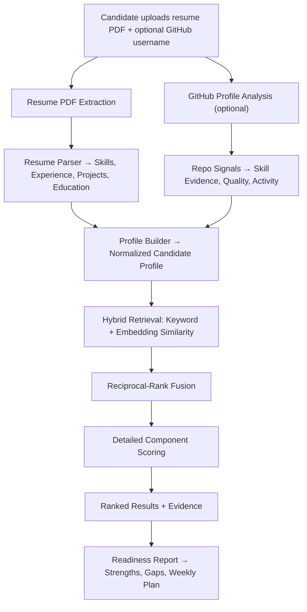

# Placement Readiness (Matchwork)

A full-stack web application that helps candidates compare their documented skills and public project evidence with real job descriptions — ranking relevant opportunities, surfacing strengths and gaps, and generating a role-specific readiness plan.

> **Advisory tool** — Matchwork is a preparation and exploration aid. It does not verify private work, replace recruiter judgment, or make hiring decisions.

---

## Table of Contents

- [Features](#features)
- [Tech Stack](#tech-stack)
- [Project Structure](#project-structure)
- [Getting Started](#getting-started)
  - [Prerequisites](#prerequisites)
  - [Backend Setup](#backend-setup)
  - [Frontend Setup](#frontend-setup)
  - [Environment Variables](#environment-variables)
- [Architecture](#architecture)
  - [Analysis Pipeline](#analysis-pipeline)
  - [Matching Model](#matching-model)
  - [Scoring Weights](#scoring-weights)
- [Screenshots](#screenshots)
- [Testing](#testing)
- [Future Work](#future-work)
- [References](#references)
- [Author](#author)

---

## Features

| Area | Description |
|------|-------------|
| **Resume Parsing** | Upload a PDF resume → extract skills, experience, projects, education, certifications, and links into structured data |
| **GitHub Analysis** | Optionally analyze public repositories for skill evidence, project quality, activity recency, collaboration, and depth |
| **Job-Description Ingestion** | Admin uploads JD PDFs → role family, seniority, must-have/nice-to-have skills, and details are structured automatically |
| **Hybrid Retrieval** | Keyword + embedding similarity with reciprocal-rank fusion narrows the candidate pool before detailed scoring |
| **Deterministic Scoring** | Inspectable, weighted component scores for resume fit, GitHub fit, and role fit — no black-box LLM scores |
| **Readiness Plans** | Qualitative strengths, gaps, suggestions, and week-by-week action plans for the selected role |
| **Resume-Only Path** | Missing GitHub evidence triggers weight rebalancing, not a penalty |
| **Role-Based Access** | Candidates see their own analyses; administrators manage job descriptions |
| **Company Directory** | Browse companies and their available role listings |
| **Offline Fallbacks** | Deterministic parsers, hashed-vector embeddings, and template plans when Gemini API is unavailable |

---

## Tech Stack

### Frontend

| Technology | Purpose |
|-----------|---------|
| **React** | Component-based UI |
| **Vite** | Dev server & production build |
| **Lucide React** | Icon set |

### Backend

| Technology | Purpose |
|-----------|---------|
| **FastAPI** | Async REST API framework |
| **Pydantic** | Request/response validation |
| **SQLAlchemy** | ORM & data models |
| **SQLite** | Default database |
| **PyJWT** | JWT authentication |
| **pdfplumber / pypdf** | PDF text extraction |
| **RapidFuzz** | Fuzzy skill matching |
| **NumPy** | Numerical scoring |
| **httpx** | Async HTTP client (GitHub API) |

### Optional Integrations

| Service | Purpose |
|---------|---------|
| **Gemini API** | Structured extraction, embeddings, explanations |
| **GitHub REST API** | Public profile & repository analysis |

---

## Project Structure

```
Project 2 AI/
├── backend/
│   ├── app/
│   │   ├── main.py                 # FastAPI application entry point
│   │   ├── api/
│   │   │   ├── deps.py             # Dependency injection (auth, DB session)
│   │   │   ├── schemas.py          # Pydantic request/response models
│   │   │   └── routes/
│   │   │       ├── auth.py         # Registration & sign-in
│   │   │       ├── analyses.py     # Create/retrieve candidate analyses
│   │   │       ├── companies.py    # Company directory endpoints
│   │   │       ├── admin.py        # Admin JD management
│   │   │       └── meta.py         # Role families & metadata
│   │   ├── core/
│   │   │   ├── config.py           # App settings & env loading
│   │   │   ├── security.py         # Password hashing & JWT
│   │   │   └── logging.py          # Structured logging
│   │   ├── db/
│   │   │   ├── database.py         # SQLAlchemy engine & session
│   │   │   ├── models.py           # ORM models (User, JD, Analysis, etc.)
│   │   │   └── repositories.py     # Data-access helpers
│   │   ├── services/
│   │   │   ├── github/             # GitHub profile & repo analyzer
│   │   │   │   ├── client.py       # GitHub REST API client
│   │   │   │   ├── analyzer.py     # Profile analysis logic
│   │   │   │   └── signals.py      # Skill/quality signal extraction
│   │   │   ├── jd/                 # Job description processing
│   │   │   │   ├── jd_extractor.py # Field extraction from JD text
│   │   │   │   └── jd_ingest.py    # PDF ingestion pipeline
│   │   │   ├── llm/                # Optional Gemini integration
│   │   │   │   ├── client.py       # Gemini API wrapper
│   │   │   │   └── schemas.py      # LLM response schemas
│   │   │   ├── matching/           # Core matching engine
│   │   │   │   ├── profile.py      # Candidate profile builder
│   │   │   │   ├── retrieval.py    # Hybrid keyword + vector retrieval
│   │   │   │   ├── reranker.py     # Reciprocal-rank fusion
│   │   │   │   └── scoring.py      # Weighted component scoring
│   │   │   ├── readiness/          # Readiness report generation
│   │   │   │   ├── gap_analysis.py # Strength & gap identification
│   │   │   │   └── report_generator.py
│   │   │   ├── resume/             # Resume processing
│   │   │   │   ├── pdf_extract.py  # PDF text extraction
│   │   │   │   └── resume_parser.py # Structured resume parsing
│   │   │   └── skills/
│   │   │       └── normalizer.py   # Skill taxonomy & normalization
│   │   ├── tests/
│   │   │   ├── conftest.py         # Test fixtures
│   │   │   ├── test_api.py         # API workflow tests
│   │   │   ├── test_scoring.py     # Score weights & bounds tests
│   │   │   ├── test_readiness.py   # Readiness plan tests
│   │   │   └── test_taxonomy.py    # Skill taxonomy tests
│   │   └── workers/                # Background job processing
│   ├── data/                       # Matching weights & config
│   ├── uploads/                    # Uploaded resume PDFs
│   ├── requirements.txt
│   └── .env.example
├── frontend/
│   ├── src/
│   │   ├── App.jsx                 # Main app component (all screens)
│   │   ├── api.js                  # Shared API client module
│   │   ├── main.jsx                # React entry point
│   │   └── styles.css              # Application styles
│   ├── index.html
│   ├── package.json
│   └── .env.example
└── JDs/                            # Job description PDFs by company
    ├── EM2 Solutions/
    ├── Ennosys/
    ├── Joveo/
    ├── Knovos/
    ├── RedixWeb/
    └── Si2 Technologies/
```

---

## Getting Started

### Prerequisites

- **Python 3.11+**
- **Node.js 18+**
- **npm** or **pnpm**

### Backend Setup

```bash
cd backend

# Create and activate virtual environment
python -m venv venv
venv\Scripts\activate        # Windows
# source venv/bin/activate   # macOS/Linux

# Install dependencies
pip install -r requirements.txt

# Configure environment
copy .env.example .env       # Windows
# cp .env.example .env       # macOS/Linux
# Edit .env with your keys (see Environment Variables below)

# Start the server
uvicorn app.main:app --reload --host 0.0.0.0 --port 8000
```

### Frontend Setup

```bash
cd frontend

# Install dependencies
npm install

# Start dev server
npm run dev
```

The frontend runs on `http://localhost:5173` and proxies API calls to the backend on `http://localhost:8000`.

### Environment Variables

Create a `.env` file in the `backend/` directory:

| Variable | Required | Description |
|----------|----------|-------------|
| `JWT_SECRET` | ✅ | Secret key for JWT token signing |
| `GITHUB_TOKEN` | ❌ | GitHub personal access token for public API |
| `GEMINI_API_KEY` | ❌ | Google Gemini API key for LLM features |
| `GEMINI_MODEL` | ❌ | Gemini model name (default: `gemini-flash-latest`) |
| `EMBEDDING_MODEL` | ❌ | Embedding model (default: `gemini-embedding-001`) |
| `DATABASE_URL` | ❌ | Database URL (default: SQLite `app.db`) |
| `TOP_N_COMPANIES` | ❌ | Max companies shown per match (default: `3`) |
| `CANDIDATE_POOL_SIZE` | ❌ | JDs entering detailed scoring (default: `50`) |
| `EXPLAIN_TOP_K` | ❌ | Top results getting AI explanations (default: `3`) |
| `ADMIN_EMAIL` | ❌ | Default admin email (default: `admin@example.com`) |
| `ADMIN_PASSWORD` | ❌ | Default admin password (default: `admin123`) |
| `MAX_UPLOAD_MB` | ❌ | Max resume upload size (default: `5`) |
| `CORS_ORIGINS` | ❌ | Allowed CORS origins (default: `*`) |

> **Note:** The app works without `GITHUB_TOKEN` and `GEMINI_API_KEY` — it falls back to deterministic parsers, hashed-vector embeddings, and template plans.

---

## Architecture

### Analysis Pipeline



### Matching Model

1. **Retrieval Stage** — Filters active JDs by role family, ranks by keyword and embedding similarity, fuses with reciprocal-rank fusion
2. **Scoring Stage** — Deterministic weighted components:
   - **Resume Fit** — Skills, experience, projects, education, resume quality
   - **GitHub Fit** — Skill evidence, project quality, activity, collaboration, depth
   - **Role Fit** — Role family and seniority alignment
3. **Explanation Stage** — Evidence-linked strengths, missing skills, and qualitative gaps
4. **Readiness Stage** — Strengths, suggestions, and staged weekly action plan

### Scoring Weights

| Component | Resume Sub-weight | Default Overall Weight |
|-----------|-------------------|----------------------|
| Skills | 50% | — |
| Experience | 20% | — |
| Project Relevance | 15% | — |
| Education | 10% | — |
| Resume Quality | 5% | — |
| **Resume Fit** | — | 55% |
| **GitHub Fit** | — | 35% |
| **Role Fit** | — | 10% |

> When GitHub is unavailable, overall weights rebalance to **80% Resume / 20% Role Fit** with no GitHub penalty.

Required JD skills carry **3×** the weight of nice-to-have skills. Partial credit is awarded for related skills.

---

## Screenshots

### Ranked Role Matches
Sample analysis comparing four roles with component-level fit breakdown (resume fit, GitHub fit, overall score), matched-skill evidence, and detail panel.

### Readiness Plan
Role-specific view separating strengths from areas to improve, with practical weekly action steps. Intentionally qualitative — no numeric score is shown to the candidate.

### Admin — Job Description Management
Interface for uploading, reviewing, and managing JD listings by company, role family, and processing status.

---

## Testing

The backend includes **25 automated tests** across four test modules:

```bash
cd backend
pytest app/tests/ -v
```

| Test Module | Coverage |
|-------------|----------|
| `test_api.py` | API workflow behavior, authentication, analysis endpoints |
| `test_scoring.py` | Score weights, bounds, component calculations, role overrides |
| `test_readiness.py` | Readiness plan generation, fallback plans, skill validation |
| `test_taxonomy.py` | Skill normalization, taxonomy mapping, confidence values |

---

## Future Work

- Measure ranking quality with consented, representative candidate–job outcome data
- Improve parsing coverage for varied resume and JD layouts
- Add transparent feedback loops for candidates and administrators
- Evaluate fairness, privacy, and performance under realistic deployment conditions
- Continue presenting results as decision support, not automated hiring decisions

---

## References

1. FastAPI — [fastapi.tiangolo.com](https://fastapi.tiangolo.com/)
2. React — [react.dev/learn](https://react.dev/learn)
3. SQLAlchemy — [docs.sqlalchemy.org](https://docs.sqlalchemy.org/)
4. GitHub REST API — [docs.github.com/en/rest](https://docs.github.com/en/rest)
5. Google Gemini API — [ai.google.dev/gemini-api/docs](https://ai.google.dev/gemini-api/docs)
6. Vite — [vite.dev/guide](https://vite.dev/guide/)

---

## Author

**Mayank Sandipbhai Kanaiya**
B.Tech. in Information Technology, Semester VII
Dharmsinh Desai University, Nadiad
Student ID: 23ITUOS050
Email: mayankkanaiya03@gmail.com

**Guide:** Prof. H. B. Prajapati

---

## License

This project was developed as an academic B.Tech. Project-2 at Dharmsinh Desai University (Oct 2026).
